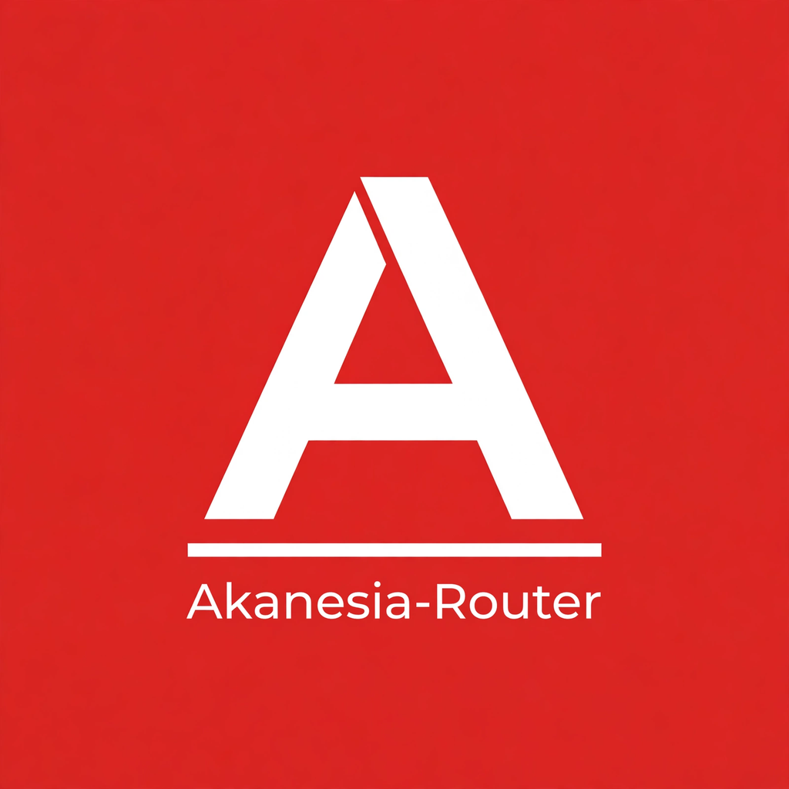

<p align="center">
  
</p>

<h1 align="center">Akanesia-Gateway (<code>akanesia-router</code>)</h1>

<p align="center">
  Gateway routing AI lokal + dashboard web. Satu endpoint kompatibel OpenAI (<code>/v1/*</code>)
  yang me-routing request ke 323 provider upstream — dengan translasi format,
  combo fallback, multi-account, quota tracking, dan token saver.
</p>

<p align="center">
  Nama paket: <code>akanesia-router</code> · Versi: <code>1.5.0</code> · Sebelumnya dikenal sebagai 9Router.
</p>

## Asal-usul

Proyek ini dikembangkan dari **[9router](https://github.com/decolua/9router)**
oleh decolua — terima kasih atas fondasi open-source-nya. Akanesia-Router
melanjutkan pengembangan secara independen dengan rebrand, ratusan provider
tambahan (hasil merge OmniRoute), dan fitur-fitur baru di bawah ini.
Lisensi tetap Apache 2.0.

## Fitur Utama

### Routing & Fallback
- **Smart routing** — round-robin & fill-first antar akun/koneksi per provider
- **Combo fallback** — rantai otomatis (langganan → murah → gratis) tanpa downtime,
  dengan deteksi error per-provider (mis. aturan khusus Codex)
- **Route-Masking** — nama samaran (alias) untuk model, dengan validasi duplikat

### Penghematan & Quota
- **RTK Token Saver** — kompres otomatis `tool_result`, hemat 20–40% token
- **Headroom dashboard** — pantau kompresi, penghematan USD, latensi, dan cache
- **Quota tracking** — pantau pemakaian & sisa kuota tiap koneksi; kartu quota
  di dashboard dengan backoff otomatis saat limit tercapai

### Translasi & Kompatibilitas
- **Translasi format** — OpenAI ↔ Claude ↔ Gemini ↔ OpenAI Responses,
  satu endpoint untuk semua
- **Universal** — kompatibel dengan Claude Code, Cursor, Cline, Codex,
  OpenCode, dan puluhan CLI tools lain (kartu konfigurasi sekali klik
  per tool di dashboard)
- **Model discovery** — `/model` picker terisi otomatis dari endpoint
  `/v1/models` gateway

### Manajemen Provider
- **323 provider** — API key, OAuth (device-code), maupun cookie-based;
  koneksi multi-akun per provider
- **Custom header per-provider** — override header HTTP per provider,
  dengan daftar blokir (Authorization, Cookie, dsb.)
- **Proxy pool** — routing via proxy HTTP/SOCKS, mode strict (fail-closed),
  pengecualian `noProxy`, dan relay Vercel/Cloudflare
- **Check Models** — impor & sinkronisasi daftar model dari endpoint
  `/models` tiap provider, manual atau terjadwal
- **Kategori model** — tab All/Premium/Free di detail provider dengan
  penandaan manual per model

### Developer Experience
- **Playground per-provider** — tab Test, Compare (2–3 model sejajar
  dengan metrik TTFT/latensi/token), dan Probe (fingerprinting model)
- **Console Log** — replay request upstream yang gagal, buffer log
  terpusat yang bisa di-streaming
- **CLI launcher** — `akanesia-router` (atau `aka-gateway`): tray icon,
  auto-update, dan perintah `connect` untuk server remote

### Keamanan & Local-first
- **Local-first** — berjalan lokal/intranet, data tetap di mesin sendiri
- API key terpisah per klien (`sk_9router`), secret tersimpan terenkripsi,
  redaksi otomatis di log

## Instalasi

Prasyarat: **Node.js 18+** (disarankan 22 LTS) dan npm.

### Cara 1 — CLI launcher (paling mudah)

```bash
npm install -g akanesia-router
akanesia-router
```

Dashboard: `http://localhost:20128/dashboard` · API: `http://localhost:20128/v1`.
Data tersimpan di `~/.9router`.

### Cara 2 — dari source

```bash
git clone https://github.com/ch0c01dxyz/akanesia-router.git
cd akanesia-router
cp .env.example .env   # isi JWT_SECRET & INITIAL_PASSWORD
npm install
npm run dev            # dev, port 20127
# atau production:
npm run build && npm start   # port 20128
```

### Windows

1. Install **Node.js LTS** dari [nodejs.org](https://nodejs.org) (centang "Add to PATH").
2. Buka PowerShell / Terminal:
   ```powershell
   npm install -g akanesia-router
   akanesia-router
   ```
3. Ikon tray muncul di system tray; server berjalan di background.

### Ubuntu / Linux

1. Install Node.js 22 dan git:
   ```bash
   curl -fsSL https://deb.nodesource.com/setup_22.x | sudo -E bash -
   sudo apt install -y nodejs git
   ```
   (alternatif: via [nvm](https://github.com/nvm-sh/nvm))
2. Agar `npm install -g` bisa tanpa sudo (disarankan):
   ```bash
   mkdir -p ~/.npm-global
   npm config set prefix ~/.npm-global
   echo 'export PATH=~/.npm-global/bin:$PATH' >> ~/.bashrc
   source ~/.bashrc
   ```
3. Install dan jalankan:
   ```bash
   npm install -g akanesia-router
   akanesia-router
   ```
4. Di server headless, CLI berjalan sebagai server biasa. Di desktop
   Linux, ikon tray tersedia bila lingkungan desktop menyediakan system tray.

## Mulai Cepat

```bash
cp .env.example .env && npm install
npm run dev      # dev server, port 20127
```

```bash
npm run build    # production build
npm start        # production server (default port 20128)
```

Arahkan CLI tool favoritmu ke `http://localhost:20128/v1` dan mulai pakai.

Perintah lain: `npx eslint .` untuk lint. Test ada di paket terpisah `tests/`
(vitest) — lihat `docs/TESTING.md`.

## Dokumentasi

- `docs/specs/` — dokumen struktur proyek: `AGENTS.md`, `ARCHITECTURE.md`,
  `CLAUDE.md`, `DESIGN.md`, `PRD.md`, `RULES.md`, `TECH_STACK.md`
  (panduan wajib dibaca sebelum mengubah repo ini)
- `docs/` — panduan deployment, keamanan, testing, changelog, dan ide pengembangan
- `open-sse/` — mesin routing & translasi provider (lihat `open-sse/AGENTS.md`
  bila menyentuh area ini)

## Lisensi

Apache License 2.0 — lihat file `LICENSE`.
