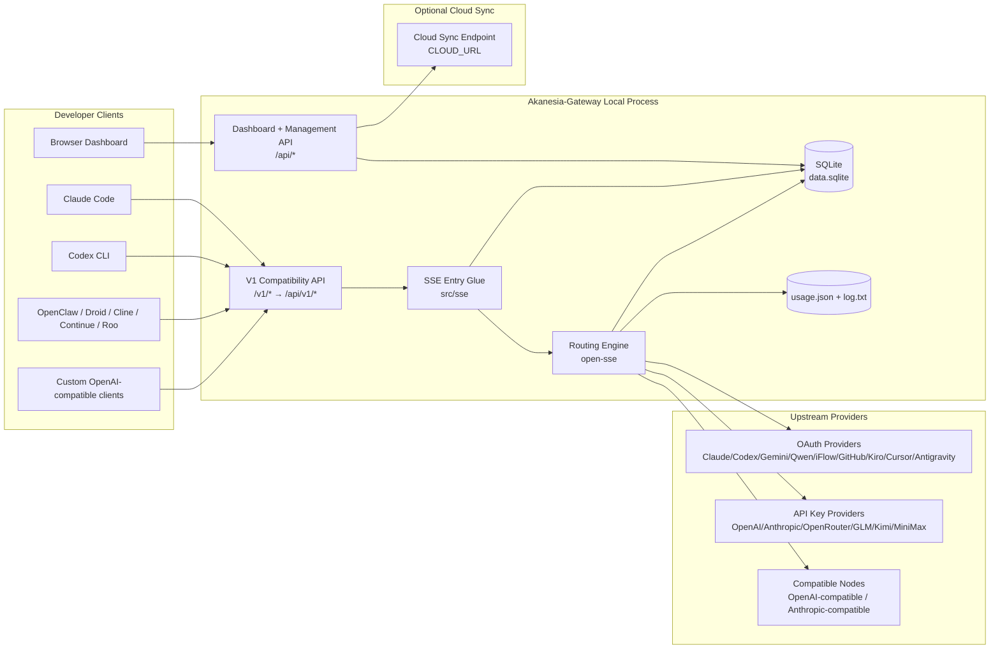
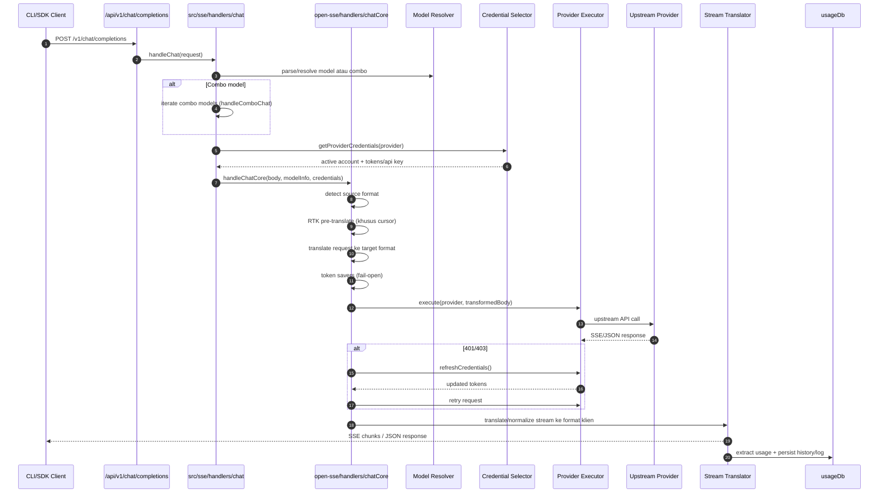
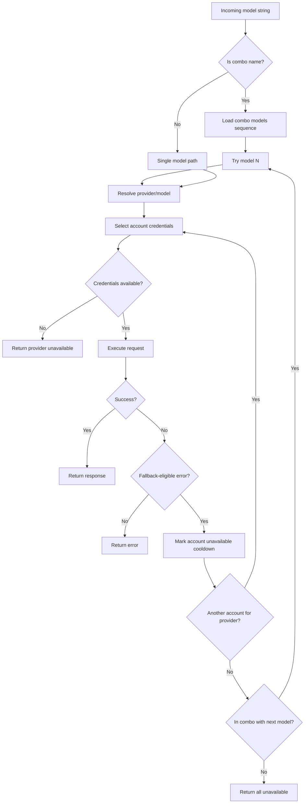
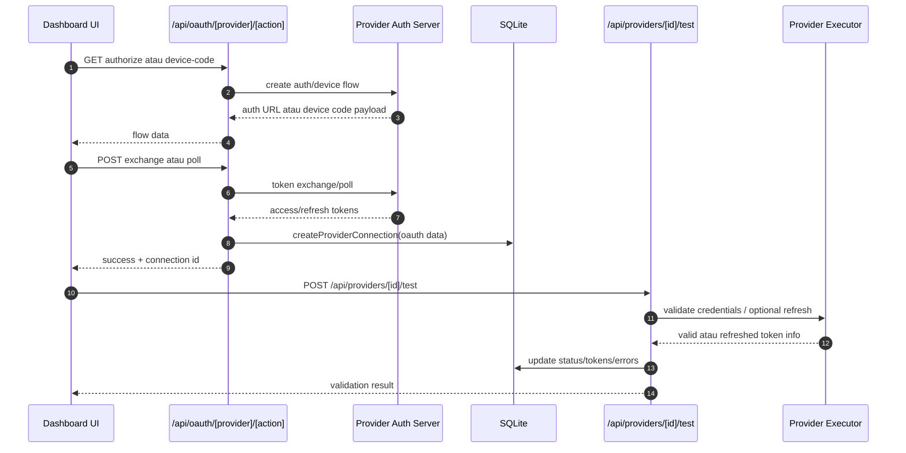
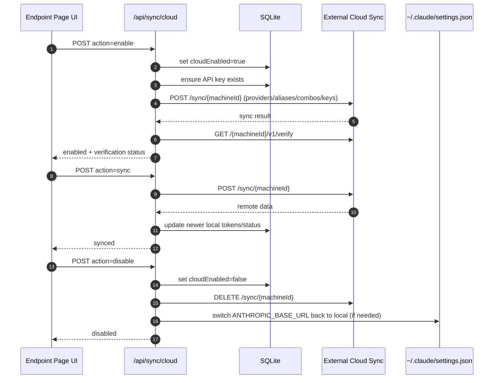
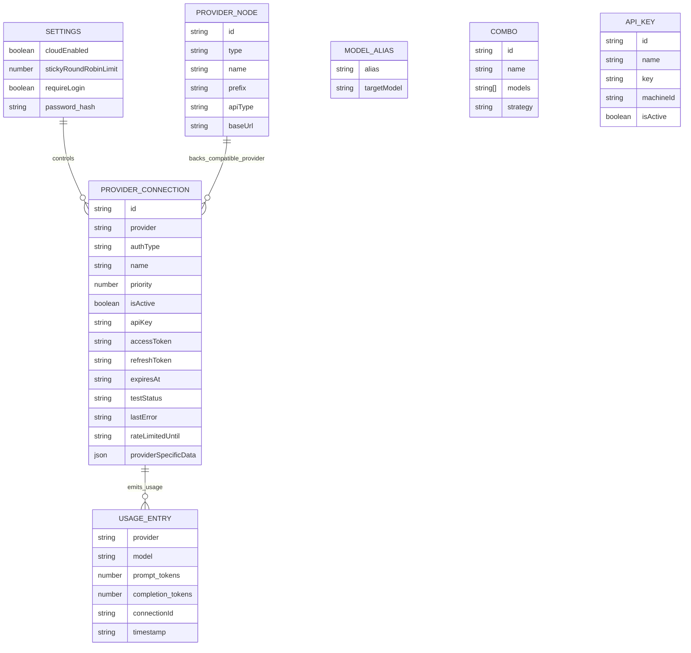
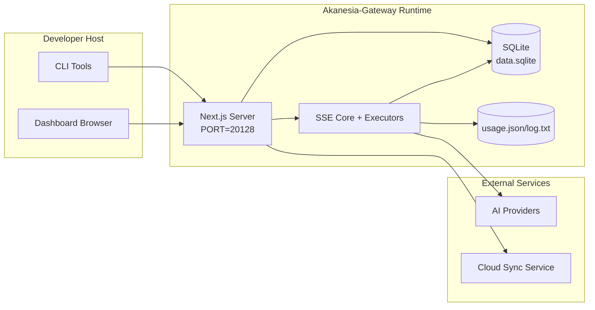

# Akanesia-Gateway Architecture (Detail)

_Diperbarui: 2026-09-29. Menggantikan versi 2026-02-06; bagian yang masih valid dipertahankan,
bagian usang (persistensi `db.json`, daftar executor) dikoreksi dari eksplorasi langsung repo v1.5.0._

## Executive Summary

Akanesia-Gateway adalah local AI routing gateway + dashboard berbasis Next.js 16. Ia menyediakan
satu endpoint kompatibel OpenAI (`/v1/*`, di-rewrite ke `/api/v1/*`) dan me-routing
trafik ke 300+ upstream provider dengan translasi format, combo fallback, account
fallback, OAuth/API-key management, token refresh, quota/usage tracking, token saver,
dan optional cloud sync.

Kemampuan inti:

- OpenAI-compatible API surface untuk CLI/tools
- Request/response translation antar format provider
- Model combo fallback (strategi: `fallback`, `round-robin`, `fill-first`)
- Account-level fallback (multi-account per provider)
- OAuth + API-key provider connection management + auto token refresh
- Persistensi lokal (SQLite) untuk connections, nodes, aliases, combos, keys, settings, pricing
- Usage/cost tracking dan request logging
- Check Models (`/api/providers/check-models`) per provider maupun semua provider
- Optional cloud sync untuk multi-device

## Scope and Boundaries

### In Scope

- Local gateway runtime
- Dashboard management APIs
- Provider authentication dan token refresh
- Request translation dan SSE streaming
- Local state + usage persistence
- Optional cloud sync orchestration

### Out of Scope

- Cloud service implementation di balik `CLOUD_URL`
- Provider SLA/control plane di luar proses lokal
- Binary CLI eksternal itu sendiri (Claude CLI, Codex CLI, dll.)

## High-Level System Context



## Core Runtime Components

### 1) API and Routing Layer (Next.js App Routes)

- `src/app/api/v1/*` dan `src/app/api/v1beta/*` — compatibility APIs.
- `src/app/api/*` — management/configuration APIs.
- Rewrite di `next.config.mjs`: `/v1/:path*` → `/api/v1/:path*`,
  `/v1beta/:path*` → `/api/v1beta/:path*`, plus alias khusus
  (`/codex/*` → `/api/v1/responses`, `/responses`, `/systemone`).

Route kompatibilitas penting:

- `src/app/api/v1/chat/completions/route.js`
- `src/app/api/v1/messages/route.js`
- `src/app/api/v1/responses/route.js` (+ `responses/compact`)
- `src/app/api/v1/models/route.js`
- `src/app/api/v1/messages/count_tokens/route.js`
- `src/app/api/v1/embeddings`, `images`, `videos`, `audio`, `search`, `web`, `systemone`
- `src/app/api/v1beta/models/route.js`

Domain manajemen:

- Auth/settings: `src/app/api/auth/*` (login, logout, status, reset-password, oidc, saml), `src/app/api/settings/*`
- Providers/connections: `src/app/api/providers*` (termasuk `check-models/`, `test-batch/`, `validate/`, `suggested-models/`)
- Provider nodes: `src/app/api/provider-nodes*`
- OAuth: `src/app/api/oauth/*`
- Keys/aliases/combos/pricing: `src/app/api/keys*`, `src/app/api/models/alias`, `src/app/api/combos*`, `src/app/api/pricing`
- Usage: `src/app/api/usage/*`
- Sync/cloud: `src/app/api/sync/*`, `src/app/api/cloud/*`
- CLI tooling helpers: `src/app/api/cli-tools/*`
- Lainnya: `health`, `init`, `locale`, `mcp`, `media-providers`, `proxy-pools`, `pxpipe`, `tags`, `translator`, `tunnel`, `version`, `shutdown`

### 2) SSE Entry Glue (`src/sse/`)

- `handlers/` — 9 file: `chat.js`, `embeddings.js`, `fetch.js`, `imageGeneration.js`,
  `search.js`, `stt.js`, `systemone.js`, `tts.js`, `videoGeneration.js`.
- `services/` — `auth.js` (pemilihan kredensial akun), `model.js`, `tokenRefresh.js`,
  `backgroundTokenRefresh.js`, `antigravityQuota.js`.
- `utils/logger.js`.

`handlers/chat.js` — pipeline inti:

1. Parse body JSON, `stripModelContextMarker` (marker `<model>[1m]` untuk Claude Code).
2. Resolusi combo: `handleComboChat` / `handleFusionChat` / `detectRequiredCapabilities`
   dari `open-sse/services/combo.js`.
3. **Account-selection loop**: `getProviderCredentials(provider, excludeConnectionIds, model)`
   memilih akun yang sehat (`markAccountUnavailable` / `clearAccountError`).
4. Delegasi ke `handleChatCore` (`open-sse/handlers/chatCore.js`) dengan translate format,
   bypass handler, pxpipe transform, dan capacity adapter.

### 3) Routing Engine (`open-sse/`)

Mesin provider-agnostic: satu request gaya OpenAI → provider apapun (LLM chat, image,
embedding, tts, stt, search, video), di-stream kembali dalam format klien.

- `handlers/chatCore.js` (518 baris) — orkestrasi chat: deteksi format → RTK
  (pre-translate khusus cursor) → `translateRequest` → token savers (fail-open) →
  `getExecutor(provider).execute()` → 401/403 → `refreshCredentials` via
  `refreshWithRetry(…, 3)` → retry sekali → `translateResponse` → SSE.
- `handlers/` lain: `embeddingsCore.js`, `imageGenerationCore.js` (+ 17 adapter di
  `imageProviders/`), `ttsCore.js`, `sttCore.js`, `videoCore.js`, `responsesHandler.js`,
  `systemoneCore.js`, `search/`, `fetch/`.
- `executors/` — `BaseExecutor` (`base.js`): `getBaseUrls`, `buildUrl`, `buildHeaders`,
  `transformRequest`, `shouldRetry` (hanya 429), `refreshCredentials`, `execute`
  (loop fallback multi-URL + retry per-status, connect-timeout via AbortController,
  `proxyAwareFetch`). `DefaultExecutor` (`default.js`, 350 baris) menangani semua
  provider OpenAI-compatible; auth descriptor `transport.auth { combined, header, scheme }`
  dibaca langsung dari registry.
- `translator/` — pivot via OpenAI; direct route untuk pasangan rapuh
  (`claude:kiro`, `kiro:claude`); self-register via `register(from, to, reqFn, resFn)`;
  13 request + 11 response translator; `schema/` untuk enum; `concerns/` untuk
  logika bersama (thinking, toolCall, image, usage, …).
- `providers/registry/` — 319 file provider (single source of truth); `registry/index.js`
  auto-generated (regen via `scripts/generate-registry-index.mjs`).
- `services/` — `combo.js` (strategi combo), `accountFallback.js`, `model.js`
  (`parseModel("provider/model")`), `tokenRefresh/`, `oauthCredentialManager.js`, `usage/`.
- `rtk/` — Request Token Killer: kompres in-place `tool_result`, fail-open.
- `transformer/` — `responsesTransformer.js` (Chat SSE → Codex Responses SSE),
  `streamToJsonConverter.js`.
- `config/` — `providers.js` (barrel), `providerModels.js`, `runtimeConfig.js`
  (timeout, token limit, retry), `errorConfig.js` (ERROR_RULES).

### 4) Persistence Layer (SQLite — menggantikan `db.json`)

Driver fallback chain (`src/lib/db/driver.js`):

```
bun:sqlite → node:sqlite (Node ≥24) → sql.js (pure JS)
```

- Barrel publik: `src/lib/db/index.js`; shim kompatibel: `src/lib/localDb.js`, `src/lib/usageDb.js`.
- Repo per-entity di `src/lib/db/repos/`: connections, nodes, combos, aliases,
  apiKeys, pricing, proxyPools, requestDetails, settings, usage, disabledModels.
- Migrasi: `src/lib/db/migrations/` (`001-initial.js`).
- Lokasi: `<DATA_DIR>/db/data.sqlite` (default `~/.9router/db/data.sqlite`);
  migrasi otomatis dari file JSON lama (`db.json`, `usage.json`, …).
- Usage/log (`usage.json` + `log.txt`) tetap di `~/.9router` dan **tidak** mengikuti `DATA_DIR`.

### 5) Auth + Security Surfaces

- Dashboard cookie auth: `src/proxy.js` (middleware Next 16), `src/app/api/auth/login/route.js`.
- Session JWT via `jose`; secret dari `JWT_SECRET` env atau file `jwt-secret` di DATA_DIR (mode 0o600).
- API key generation/verification: `src/shared/utils/apiKey.js` (HMAC via `API_KEY_SECRET`).
- Provider secrets tersimpan di `providerConnections`.
- Outbound proxy via env (`open-sse/utils/proxyFetch.js`).
- `custom-server.js`: anti-spoof IP klien (turunkan dari TCP socket, hapus header
  kiriman klien, percaya `X-Forwarded-For` hanya dari loopback reverse proxy).

### 6) Cloud Sync

- Scheduler init: `src/lib/initCloudSync.js`, `src/shared/services/initializeCloudSync.js`.
- Periodic task: `src/shared/services/cloudSyncScheduler.js`.
- Control route: `src/app/api/sync/cloud/route.js`.

## Request Lifecycle (`/v1/chat/completions`)



## Combo + Account Fallback Flow



Strategi combo (`open-sse/services/combo.js`):

| Strategi | Perilaku |
|---|---|
| `fallback` | Coba model berurutan; pindah ke berikut bila gagal |
| `round-robin` | Rotasi per request; state `{index, consecutiveUseCount}` per combo + `stickyLimit` |
| `fill-first` | Pointer tidak maju per request; menetap di model pertama yang sukses sampai gagal, lalu pindah dan menetap |

Fallback decisions: `open-sse/services/accountFallback.js` memakai `ERROR_RULES`
(`config/errorConfig.js`) — cocokkan teks error dulu, lalu status. 429 → backoff
eksponensial (1s, 2s, 4s, … maks 4 menit). Client-error 4xx non-401/402/403/429
tidak trigger fallback.

## OAuth Onboarding and Token Refresh Lifecycle



Refresh saat live traffic: di `open-sse/handlers/chatCore.js` via executor
`refreshCredentials()`. `oauthCredentialManager.js`: refresh bila `expiresAt` dalam
lead time, atau proaktif stale untuk provider dengan `oauth.maxRefreshAgeMs`
(codex: 8 hari). Dedup via lock per-refresh.

## Check Models Flow

`POST /api/providers/check-models` — `{ mode: "all" }` atau `{ mode: "provider", providerId }`.
Memakai `transport.validateUrl` atau public `modelsFetcher`; timeout 15 detik,
concurrency 5. Auth mengikuti `transport.auth` (bearer → `Authorization: Bearer`,
raw header custom, `key` → query param; `none`/`optional` jalan tanpa key;
OAuth tanpa public fetcher, cookie/session, AWS SigV4 → `skipped`).

## Cloud Sync Lifecycle (Enable / Sync / Disable)



## Data Model and Storage Map



File fisik:

- State utama: `<DATA_DIR>/db/data.sqlite` (default `~/.9router/db/data.sqlite`)
- Usage stats: `~/.9router/usage.json`
- Request log: `~/.9router/log.txt`
- Debug request/translation: `<repo>/logs/...` (bila `ENABLE_REQUEST_LOGS=true`)

## Deployment Topology



## Module Mapping (Decision-Critical)

### Route and API Modules

- `src/app/api/v1/*`, `src/app/api/v1beta/*`: compatibility APIs
- `src/app/api/providers*`: provider CRUD, validation, testing, check-models
- `src/app/api/provider-nodes*`: custom compatible node management
- `src/app/api/oauth/*`: OAuth/device-code flows
- `src/app/api/keys*`: local API key lifecycle
- `src/app/api/models/alias`: alias management
- `src/app/api/combos*`: fallback combo management
- `src/app/api/pricing`: pricing overrides untuk cost calculation
- `src/app/api/usage/*`: usage dan logs APIs
- `src/app/api/sync/*` + `src/app/api/cloud/*`: cloud sync dan cloud-facing helpers
- `src/app/api/cli-tools/*`: local CLI config writers/checkers

### Routing and Execution Core

- `src/sse/handlers/chat.js`: request parse, combo handling, account selection loop
- `open-sse/handlers/chatCore.js`: translation, executor dispatch, retry/refresh, stream setup
- `open-sse/executors/*`: provider-specific network dan format behavior
- `open-sse/services/combo.js`, `accountFallback.js`, `model.js`: routing policy

### Translation Registry and Format Converters

- `open-sse/translator/index.js`: translator registry dan orchestration
- Request translators: `open-sse/translator/request/*`
- Response translators: `open-sse/translator/response/*`
- Format constants: `open-sse/translator/formats.js` (14 format)

### Persistence

- `src/lib/db/index.js`: barrel publik; `src/lib/db/repos/*`: repo per-entity
- `src/lib/db/driver.js`: adapter fallback chain
- `src/lib/localDb.js`, `src/lib/usageDb.js`: shim backward-compat

## Provider Executor Coverage

Executor khusus (subset — daftar lengkap di `open-sse/executors/index.js`):

- Protokol biner/khusus: `kiro` (EventStream), `cursor` (protobuf ConnectRPC),
  `commandcode` (NDJSON), `antigravity`, `gemini-cli`, `github`, `ghe-copilot`,
  `codex`, `opencode`, `zed`, `iflow`, `devin-cli`, `clova-studio`, `bedrock` (SigV4 manual)
- Web/cookie/session: `chatgpt-web`, `copilot-web`, `huggingchat`, `lmarena`, dll.

Default executor path:

- Semua provider OpenAI-compatible lain (termasuk compatible node providers)
  memakai `open-sse/executors/default.js`.

> Catatan operasional: beberapa file executor diimpor tapi belum terdaftar di map
> `executors/index.js` — provider tersebut diam-diam jatuh ke `DefaultExecutor`.
> Audit berkala diperlukan.

## Format Translation Coverage

Source format terdeteksi: `openai`, `openai-responses`, `claude`, `gemini`.
Target: OpenAI chat/Responses, Claude, Gemini/Gemini-CLI/Antigravity envelope,
Kiro, Cursor, Ollama, CommandCode, Clova.

## Failure Modes and Resilience

1. **Account/Provider Availability** — cooldown akun pada transient/rate/auth error;
   account fallback sebelum gagal; combo model fallback bila path habis.
2. **Token Expiry** — pre-check dan refresh dengan retry; 401/403 retry setelah refresh.
3. **Stream Safety** — disconnect-aware stream controller; flush akhir stream;
   `[DONE]` handling; estimasi usage bila metadata provider hilang.
4. **Cloud Sync Degradation** — error sync di-surface tapi runtime lokal lanjut.
5. **Data Integrity** — migrasi/repair schema; safeguard reset untuk DB korup.

## Observability and Operational Signals

- Console logs dari `src/sse/utils/logger.js`
- Agregat usage per-request di `usage.json`
- Status log tekstual di `log.txt`
- Deep request/translation logs di `logs/` bila `ENABLE_REQUEST_LOGS=true`
- Dashboard usage endpoints (`/api/usage/*`)

## Security-Sensitive Boundaries

- `JWT_SECRET` — signing/verifikasi cookie sesi dashboard
- `INITIAL_PASSWORD` (default `123456`) — wajib dioverride di deployment nyata
- `API_KEY_SECRET` — HMAC untuk format API key lokal
- Provider secrets (API keys/tokens) tersimpan di DB lokal — lindungi di level filesystem
- Cloud sync: API key auth + machine id semantics
- Detail: `docs/SECURITY.md`

## Environment and Runtime Matrix

- App/auth: `JWT_SECRET`, `INITIAL_PASSWORD`
- Storage: `DATA_DIR`
- Security hashing: `API_KEY_SECRET`, `MACHINE_ID_SALT`
- Logging: `ENABLE_REQUEST_LOGS`, `OBSERVABILITY_ENABLED`, `AUTH_COOKIE_SECURE`, `REQUIRE_API_KEY`
- Sync/cloud: `BASE_URL`, `CLOUD_URL`, `NEXT_PUBLIC_BASE_URL`, `NEXT_PUBLIC_CLOUD_URL`
- Outbound proxy: `HTTP_PROXY`, `HTTPS_PROXY`, `ALL_PROXY`, `NO_PROXY` (+ lowercase)
- Platform: `NODE_ENV`, `PORT`, `HOSTNAME`

## Known Architectural Notes

1. `usageDb` (`usage.json`/`log.txt`) tidak mengikuti `DATA_DIR`.
2. Registry index auto-generated — 25 entry baru (per 2026-09-29) belum masuk
   `registry/index.js`; regen sebelum dianggap aktif di routing.
3. Request logger menulis header/body penuh bila enabled — perlakukan direktori log sebagai sensitif.
4. Cloud behavior bergantung pada `NEXT_PUBLIC_BASE_URL` yang benar dan reachability endpoint.
5. `videoCore.js` tidak pernah auto-retry pembuatan job (risiko tagih ganda).
6. Test suite tidak diharapkan hijau semua pada checkout polos — ada known-fails
   yang dikatalogkan; gunakan script baseline untuk regresi.

## Operational Verification Checklist

- Build: `npm run build`
- Docker: `docker build -t akanesia-router .`
- Verifikasi: `GET /api/health`, `GET /api/settings`, `GET /api/v1/models`
- CLI target base URL: `http://<host>:20128/v1` (prod) — script dev memakai port 20127
